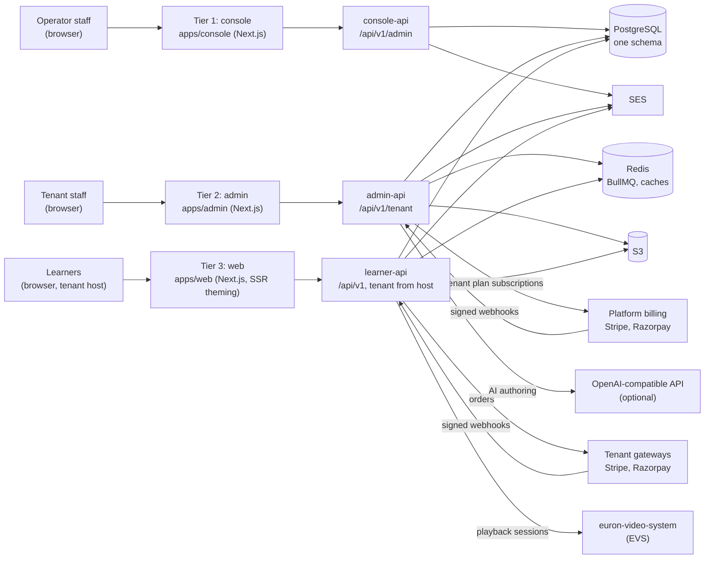
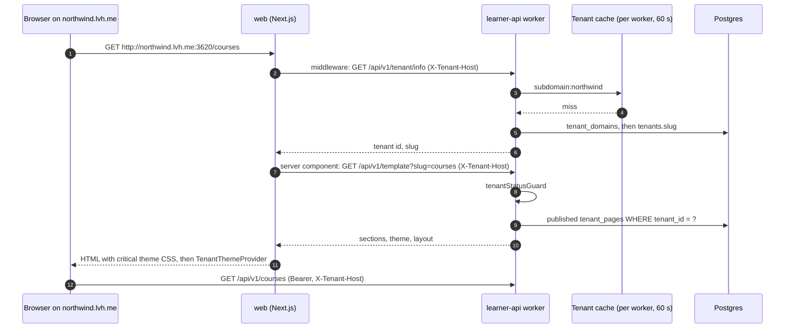
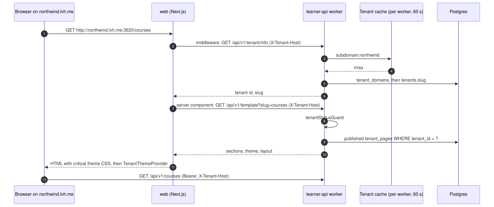

# High-level design (HLD)

Euron Open Multi-Tenant LMS (in-app brand: Open LMS Cloud) is a self-hosted, three-tier,
multi-tenant learning platform. An operator runs one deployment and sells plans to tenants
(academies, training companies, creators). Each tenant builds courses, books, bundles,
batches, test series, quizzes, assignments and certificates, designs a storefront from JSON
page templates, connects its own Stripe or Razorpay account, and sells to learners on its own
subdomain or custom domain.

Paths are relative to the repository root.

| Topic | Page |
| --- | --- |
| Apps, layers, workers and queues in code | [LLD.md](LLD.md) |
| Table groups and relationships | [data-model.md](data-model.md) |
| Catalog, plans, the entitlement snapshot, usage counters | [multi-tenancy-and-entitlements.md](multi-tenancy-and-entitlements.md) |
| Page JSON, the section registry, two-layer theming | [templates-and-theming.md](templates-and-theming.md) |
| Playback through euron-video-system or external URLs | [video.md](video.md) |
| Gateways, checkout, fulfillment, price books, platform billing | [payments-and-currency.md](payments-and-currency.md) |
| AI authoring: provider, offline mode, gate | [ai-authoring.md](ai-authoring.md) |
| Security controls and known gaps | [security.md](security.md) |
| STRIDE analysis | [threat-model.md](threat-model.md) |
| Decisions and trade-offs | [../adr/](../adr/README.md) |

## 1. System context

Source: [`docs/diagrams/context.mmd`](../diagrams/context.mmd).

## 2. Three tiers, three APIs, one database

| Tier | Who | Front end | API | Port (local) | Tenant comes from |
| --- | --- | --- | --- | --- | --- |
| 1 | Operator staff | [`apps/console`](../../apps/console) (Next.js 14, React Query v3, React Context) | [`apps/console-api`](../../apps/console-api), `/api/v1/admin/*` | 3600, 5076 | None: the operator plane is platform-wide; tenant ids are path parameters |
| 2 | Tenant staff | [`apps/admin`](../../apps/admin) (Next.js 14, TanStack Query v5, Zustand) | [`apps/admin-api`](../../apps/admin-api), `/api/v1/tenant/*` and `/api/v1/pages` | 3610, 5086 | The staff JWT plus the `X-Tenant-Id` header, checked against an active staff membership |
| 3 | Learners | [`apps/web`](../../apps/web) (Next.js 14, TanStack Query v5, Zustand, `next-themes`) | [`apps/learner-api`](../../apps/learner-api), `/api/v1/*` | 3620, 5096 | The host name (`X-Tenant-Host` or `Host`): a subdomain of `ROOT_DOMAIN` or a verified custom domain |

All three APIs are Express 5 with Kysely over one PostgreSQL database
([`packages/db/prisma/schema.prisma`](../../packages/db/prisma/schema.prisma), 167 tables),
migrated by [`db/migrate.ts`](../../db/migrate.ts) ([ADR 0001](../adr/0001-three-apis-one-schema.md),
[ADR 0002](../adr/0002-kysely-and-sql-migrations.md)). Redis carries the BullMQ queues of
admin-api and learner-api, the learner-api cache-bust channel, learner-api's sign-in rate
limit counters, and the platform's other shared counters. S3 holds files; SES sends mail.

[`apps/stubs`](../../apps/stubs/README.md) is a fourth, local-only process that stands in for
Stripe, Razorpay, EVS and an OpenAI-compatible API, so the whole product runs with no
provider account ([ADR 0006](../adr/0006-floci-for-local-aws.md) covers AWS locally).

## 3. What each tier does

| Tier 1: operator | Tier 2: tenant admin | Tier 3: learner |
| --- | --- | --- |
| Applications, features and products (BOOLEAN, COUNT, LIMIT) | Courses (sections, lessons, lectures), books, bundles, batches | Storefront pages, catalog, search, cart |
| Plans and immutable plan versions; offer versions | Test series, tests, question banks, quizzes, assignments, grading | Checkout through the tenant's gateway, coupons, currencies |
| Tenants, their staff, applications, add-ons | Certificates and certificate templates | Classroom: lectures, progress, watch time |
| Assigning a plan: subscription snapshot into entitlements | Pages, page templates, themes, layout and navigation | Tests, quizzes, assignments, report cards |
| Overrides, admin grants, usage reset and reconcile | Coupons, multi-currency price books, gateway connections | Certificates, verification, invoices |
| Billing provider definitions; audit | Paying the operator for a plan (platform billing) | Learner subscriptions (Razorpay) |
| | AI authoring, members, team and roles, email sending domains | Profile, notifications |

## 4. Tenant resolution

The learner API decides the tenant of every request from the host, in
[`apps/learner-api/src/middlewares/tenant-resolver.middleware.ts`](../../apps/learner-api/src/middlewares/tenant-resolver.middleware.ts):

1. Host is `X-Tenant-Host`, else `Host`, lowercased, port removed. The storefront sends
   `X-Tenant-Host` because the browser calls the API on its own host
   (`api.<domain>`, or `localhost:5096` locally).
2. **Subdomain of `ROOT_DOMAIN`** (for example `northwind.lvh.me`): the label before the root
   domain, unless it is in `RESERVED_SUBDOMAINS` (`www, admin, api, console, api-console,
   api-admin, assets`). Looked up as `tenant_domains.domain_name = .<ROOT_DOMAIN>`, then
   `tenant_domains.subdomain_prefix`, then `tenants.slug` (active rows first, then any status
   except `FAILED` and `REMOVING`).
3. **Custom domain** (any host not under the root domain): `tenant_domains.domain_name` with
   status `ACTIVE`, the same for the apex when the host starts with `www.`, then the older
   `tenants.custom_domain` column.
4. **Local development** (`NODE_ENV` `development` or `local`): `<slug>.localhost` also
   resolves, and custom domains match in any status.
5. The answer, including "no tenant", is cached per worker for 60 seconds; tenant config
   changes are broadcast on the Redis channel `<CACHE_BUS_PREFIX>cache-bust:tenant-config`.
6. `tenantStatusGuard` then applies the tenant's status: `ACTIVE` passes; `SUSPENDED` allows
   only `GET` and `HEAD` (403 otherwise); any other status answers 503. A request with no
   tenant passes through, and each route that needs one refuses it.
7. A learner token is accepted only when its `tenantId` equals the tenant resolved here, so a
   session from one storefront does not work on another
   ([security.md](security.md#1-authentication-per-tier)).

`lvh.me` and all its subdomains resolve to `127.0.0.1`, so `http://northwind.lvh.me:3620`
works locally with no hosts file. On AWS the load balancer sends every host it does not
route elsewhere to the `web` service, so `<tenant>.<domain>` and any custom domain with a
certificate on the listener reach the storefront ([deploy-aws.md](../guides/deploy-aws.md#hosts)).

## 5. One storefront request

Source: [`docs/diagrams/request-and-tenant-resolution.mmd`](../diagrams/request-and-tenant-resolution.mmd).

Tenant admin requests carry `Authorization: Bearer <staff token>` and `X-Tenant-Id`; the
admin middleware requires an active staff membership in that tenant, then checks the
permission code of the route, then (for gated features) the tenant's entitlement.

## 6. Background work

| API | Runs |
| --- | --- |
| console-api | Nothing in the background |
| admin-api | 21 BullMQ queues (workers and schedulers) (AI generation jobs, bulk imports, exports, domain and email domain verification, email reputation and health sweeps, platform subscription grace periods, dunning and poll reconciliation, usage reconciliation every 30 minutes, FX refresh), a footer sync loop, and the SES events SQS consumer |
| learner-api | `webhook-fulfillment`, `user-notification`, `subscription-lifecycle`, `watch-time-rollup`, the cache-bust subscriber, and a search view refresh every 5 minutes |

There is no separate worker service: each API task runs a Node cluster, and the workers run
inside it ([LLD.md](LLD.md#background-work)).

## 7. Deployment

Locally, `make up` runs everything in Docker Compose on the Floci AWS emulator
([quickstart-local.md](../guides/quickstart-local.md)). On AWS, Terraform builds a VPC, RDS,
ElastiCache, S3 with CloudFront for public media, SES, a WAF and one ALB in front of six
Fargate services routed by host ([deploy-aws.md](../guides/deploy-aws.md)).

