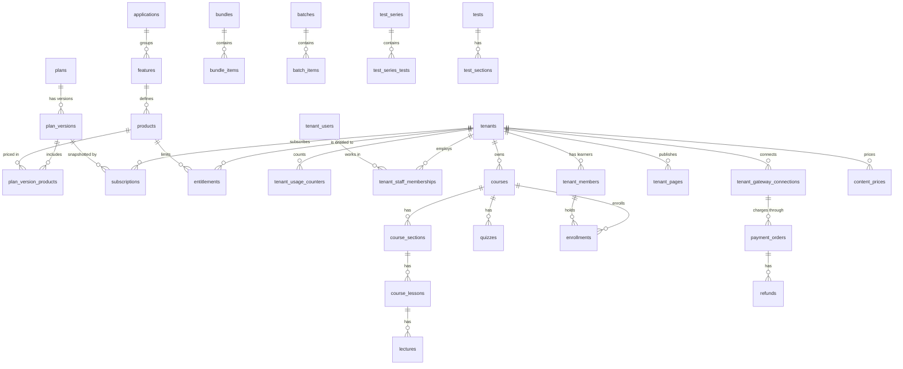

# Data model

The schema is defined in [`packages/db/prisma/schema.prisma`](../../packages/db/prisma/schema.prisma)
and applied as SQL from [`db/migrations`](../../db/migrations) by
[`db/migrate.ts`](../../db/migrate.ts). Prisma only generates the Kysely types
(`packages/db/generated/types.ts`, `enums.ts`, copied into each API's `src/db/`); it never
runs at runtime ([ADR 0002](../adr/0002-kysely-and-sql-migrations.md)). 167 tables, 108
enums, one schema shared by the three APIs.

## Conventions

- Primary keys are ULIDs stored as `text`, minted in code.
- Tenant-owned tables have a required `tenant_id` with a foreign key to `tenants`
  (`ON DELETE CASCADE`). Natural unique keys lead with it: `courses (tenant_id, slug)`,
  `tenant_pages (tenant_id, slug)`, `coupons (tenant_id, code)`,
  `tenant_members (tenant_id, email)`.
- Tables without `tenant_id` are the platform's: the catalog (`applications`, `features`,
  `products`, `plans`, `plan_versions`, `plan_version_products`, `plan_applications`,
  `addons`), operator users and roles (`admin_*`), `billing_providers`, `billing_webhooks`,
  `platform_exchange_rates`, `tenants` itself, the tenant-staff identity tables
  (`tenant_users`, `tenant_permissions`, `tenant_role_permissions`, `tenant_user_roles`), a
  few OTP and receipt helper tables, and `entitlement_overrides` (reached through its
  entitlement).
- Timestamps are `timestamp(3)` without time zone, written and read as UTC.
- Money is `numeric` in major units (`Decimal(16,2)` on orders, `Decimal(10,2)` on plan
  prices). Gateways get minor units through `toSmallestUnit(amount, currency)`, which uses
  the ISO 4217 decimals in the currency registry.
- Flexible structures are `jsonb`: page sections and themes, order metadata, gateway
  credentials (sealed), test analytics.
- Additions outside Prisma's reach are in `0002_indexes.sql` (`pg_trgm`, `unaccent`, the
  partial unique index `tenant_currencies_one_default`, read-path indexes) and
  `0003_search.sql` (`tenant_search_view` and the materialized `tenant_search_mv`).

## Platform catalog and plans (tier 1)

| Table | Holds |
| --- | --- |
| `applications` | Sellable applications (the seed creates `lms`) |
| `features` | Feature keys inside an application (`books`, `batches`, `ai_authoring`, ...) with navigation metadata |
| `products` | Measurable units of a feature: `code`, `constraint_type` (`BOOLEAN`, `COUNT`, `LIMIT`), `usage_scope` (`TENANT`, `USER`), `usage_window` (`LIFETIME`, `MONTHLY`, `YEARLY`, `DAILY`), `is_hard_limit` |
| `plans` | `code`, `name`, `plan_type` (`SINGLE_APP`, `BUNDLE`, `ENTERPRISE`), visibility, order |
| `plan_versions` | Versioned price and terms: INR and USD prices per cycle (monthly, yearly, two-yearly) with discounts, `pricing_frequency`, `purchase_mode` (`FREE`, `PAID`), `grace_period_days`, offer fields, `is_active`, `published_at`, `retired_at`. Unique `(plan_id, version)` |
| `plan_version_products` | The limit of each product in a version (`limit_value`, `is_unlimited`) |
| `plan_applications` | Which applications a plan grants |
| `plan_version_billing_mappings` | External plan ids at billing providers |
| `addons` | Purchasable extras that add entitlements |
| `billing_providers` | `RAZORPAY`, `STRIPE`: `credential_schema`, `is_active`, `is_visible_to_tenant` |
| `admin_users`, `admin_roles`, `admin_permissions`, `admin_role_permissions`, `admin_user_roles`, `admin_audit_logs` | Operator identity, RBAC and audit |

## Tenants and their runtime limits

| Table | Holds |
| --- | --- |
| `tenants` | `slug` (unique), legacy `custom_domain`, `owner_user_id`, `status` (`PENDING`, `ACTIVE`, `SUSPENDED`, `CANCELLED`), `layout` (header, footer, nav JSON), storefront switches (access-managed, enrolled-courses-only, sequential courses, ordered products), certificate defaults, locales, email sending status |
| `tenant_domains` | `domain_type` (`SUBDOMAIN`, `CUSTOM`), `domain_name` (unique), `subdomain_prefix`, `status` (`PENDING_VERIFICATION` ... `ACTIVE`), `is_primary`, SSL and verification state |
| `subscriptions` | A tenant's plan: `plan_version_id`, snapshots (`plan_code_snapshot`, `plan_name_snapshot`, `plan_version_snapshot`, `price_snapshot`, `currency`, `billing_cycle`), period, `status` (`PENDING`, `ACTIVE`, `PAST_DUE`, `CANCELLED`, `EXPIRED`, `TRIALING`), grace and dunning fields, external ids |
| `subscription_events`, `tenant_subscription_events`, `pending_subscription_checkouts` | Lifecycle history and checkouts awaiting their webhook |
| `tenant_applications` | Applications a tenant may use, with `source` (`SUBSCRIPTION`, `ADMIN_TRIAL`, `ADMIN_GRANT`, `PROMO`) and status |
| `entitlements` | One row per tenant and product: `limit_value`, `is_unlimited`, `source` (`PLAN`, `ADMIN`, `ADDON`, `PROMO`), the subscription, plan version or add-on it came from, `is_active`, `archived_at`. `used_value` is deprecated |
| `entitlement_overrides` | Every manual limit change: old value, new value, reason, operator |
| `tenant_usage_counters` | Consumption: unique `(tenant_id, product_code, scope_type, scope_id, window_type, window_start)` (`window_start` is `1970-01-01` for lifetime counters), `current_value`, reconciliation fields |
| `tenant_usage_events` | Append-only audit of consume, release and reconcile: `delta`, `resulting_value`, resource, actor, unique `idempotency_key` |
| `tenant_addons`, `tenant_addon_events`, `addon_subscriptions` | Add-ons a tenant holds |
| `content_product_links` | Ties a product to specific content (course, book, bundle, batch), unique per tenant, product and content |
| `invoices`, `payment_receipts`, `payment_receipt_items`, `payment_receipt_counters` | Invoices and receipts for platform and learner payments |

How these are written and read: [multi-tenancy-and-entitlements.md](multi-tenancy-and-entitlements.md).

## People

| Table | Holds |
| --- | --- |
| `tenant_users` | Tenant staff identity, global across tenants (one person can work in several) |
| `tenant_staff_memberships` | Staff in a tenant: unique `(tenant_id, user_id)`, status |
| `tenant_roles`, `tenant_permissions`, `tenant_role_permissions`, `tenant_user_roles` | Staff RBAC; `tenant_roles.tenant_id` is null for the global roles |
| `tenant_members` | Learners, per tenant: unique `(tenant_id, email)` and `(tenant_id, phone)`, status, profile metadata (including `preferred_currency`) |
| `tenant_member_sessions` | One active session per learner (`session_token`), checked on every learner request |
| `tenant_otp_codes`, `tenant_password_resets`, `tenant_admin_otp_codes`, `tenant_admin_signup_otp_codes` | One-time codes and reset tokens |
| `tenant_auth_config`, `tenant_member_form_config`, `tenant_member_form_responses` | Per-tenant sign-in options and the learner profile form |
| `tenant_audit_logs` | Tenant staff actions |

## Content

| Group | Tables |
| --- | --- |
| Courses | `courses` (`status`, `mode` (`SELF_PACED`, the only value), `course_type`, pricing and legacy `price_inr`, `price_usd`, `certificate_template_id`, prerequisites), `course_sections`, `course_lessons` (`type`, `is_preview`), `lectures` (`video_provider`, `video_key`, `processing_status`), `lesson_resources`, `course_instructors`, `course_categories`, `course_faqs`, `course_reviews`, `course_review_votes`, `course_syllabus_sections`, `course_syllabus_items`, `course_recommendations` |
| Books | `books`, `book_authors`, `book_categories`, `book_conversions`, `book_recommendations` |
| Bundles and batches | `bundles`, `bundle_items` (a course, book or test series), `batches`, `batch_items` (a course or book), `batch_leaderboard_snapshots` |
| Quizzes and assignments | `quizzes`, `quiz_questions`, `quiz_options`, `assignments`, `assignment_evaluations` |
| Test series | `test_series`, `test_series_tests`, `tests`, `test_sections`, `test_modules` (adaptive stages), `test_module_questions`, `test_module_score_scales`, `test_section_questions`, `test_questions`, `test_question_banks`, `test_taxonomy_nodes`, `test_exam_rank_curves`, `test_norm_tables`, `test_scholarships`, `test_coupons`, `question_upload_assets`, `question_serve_stats` |
| Certificates | `certificate_templates`, `certificates` (unique `(tenant_id, certificate_number)`), `certificate_batches`, `bulk_certificates`, `tenant_certificate_assignments`, `test_certificates` |
| Catalog helpers | `categories`, `instructors`, `instructor_experiences`, `instructor_socials`, `testimonials`, `content_translations`, `tenant_locales` |
| Storefront | `tenant_pages` (sections, theme, SEO, custom HTML, publish state; unique `(tenant_id, slug)`), `tenant_page_revisions`, `tenant_nav_items`, `tenant_org_details` |

A course and its landing page are created together: a `courses` row with slug `<slug>` and a
`tenant_pages` row with slug `courses/<slug>`. Books follow the same pattern with
`books/<slug>`. Deleting a course deletes both.

## Learning records

| Table | Holds |
| --- | --- |
| `enrollments` | Course access: unique per tenant, member and course; `status`, `source` (`PURCHASED`, `BUNDLE`, `BATCH`, ...), `valid_till`, source bundle, batch or coupon |
| `book_access`, `batch_enrollments`, `test_series_enrollments` | The same for books, batches and test series |
| `member_lecture_progress`, `member_lesson_progress`, `member_quiz_progress`, `member_assignment_progress` | Progress per item |
| `lecture_watch_sessions`, `tenant_watch_time_daily`, `watch_time_rollup_state`, `lecture_dropoff_buckets` | Watch time from player heartbeats and its rollups |
| `quiz_attempts`, `quiz_attempt_answers`, `assignment_submissions` | Quiz and assignment work |
| `test_attempts`, `test_attempt_modules`, `test_attempt_answers`, `test_bookmarks`, `test_scholarship_awards` | Test attempts with scores, percentile, rank prediction and proctoring flags |
| `member_bookmarks`, `member_book_progress`, `member_book_highlights`, `member_book_page_bookmarks`, `member_notifications` | Reader and notification state |
| `tenant_active_learners_daily`, `usage_events` | Analytics rollups |

## Commerce

| Table | Holds |
| --- | --- |
| `tenant_gateway_connections` | A tenant's Stripe or Razorpay account: `provider_id`, `mode` (`SELF_MANAGED`), `credentials_encrypted` (`{ cipher: "enc:v1:..." }`), `is_active`, `is_verified`, status |
| `payment_orders` | One order: `order_type` (`COURSE`, `BOOK`, `BUNDLE`, `CART`, `BATCH`, `TEST_SERIES`), `item_id`, `currency`, amounts (base, discount, net, tax, total), coupon snapshot, gateway ids, `status`, `idempotency_key` (unique), `metadata` (including `fulfilled`), FX snapshot (`fx_rate_to_tenant_default`, `resolved_country`, `tenant_default_currency`). Unique `(tenant_id, order_number)` |
| `cart_items`, `cart_order_items` | Cart contents and the items of a cart order |
| `payment_webhook_events` | Gateway events: unique `(tenant_id, provider_name, event_id)`, status, payload |
| `refunds` | Refunds against an order; no code writes it today (refunds are made in the gateway dashboard) |
| `coupons`, `coupon_applicable_items`, `coupon_redemptions` | Coupons: `discount_type` (`PERCENTAGE`, `FIXED`), `currency` (required for `FIXED`), limits, applicable items, redemptions |
| `content_prices` | Price book: one row per tenant, `entity_type` (`COURSE`, `BOOK`, `BUNDLE`, `BATCH`, `TEST_SERIES`), `entity_id` and currency |
| `tenant_currencies` | Enabled currencies: `is_default` (exactly one, partial unique index), `countries` (ISO codes, `*` for the rest of the world), `is_active`, `sort_order` |
| `platform_exchange_rates` | Cached FX rates (display and order snapshots only) |
| `tenant_subscription_plans`, `tenant_user_subscriptions` | Learner subscriptions a tenant sells (Razorpay) |
| `member_payment_details` | Saved learner billing details |
| `billing_webhooks` | Platform billing events (unique `event_id`) |

Details: [payments-and-currency.md](payments-and-currency.md).

## Email

`tenant_email_sending_domains`, `tenant_email_sender_identities`, `tenant_email_messages`,
`tenant_email_suppressions`, `tenant_email_reputation_events`,
`tenant_email_domain_health_checks`, `platform_notification_suppressions`: per-tenant SES
sending domains, the messages sent, suppression lists and the reputation sweep's evidence.

## Other

`tenant_bulk_imports` (member imports), `tenant_nudge_dismissals`, `tenant_org_details`
(legal, contact and social details).
