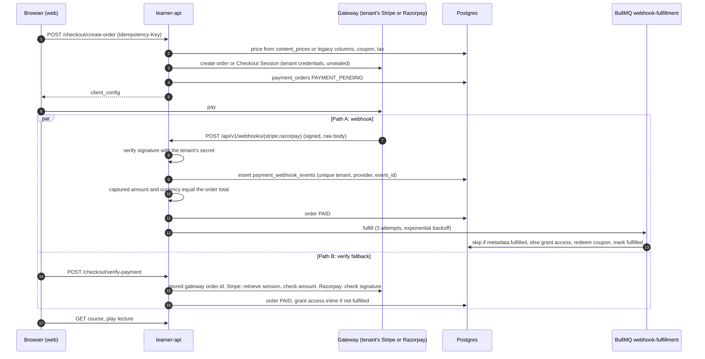
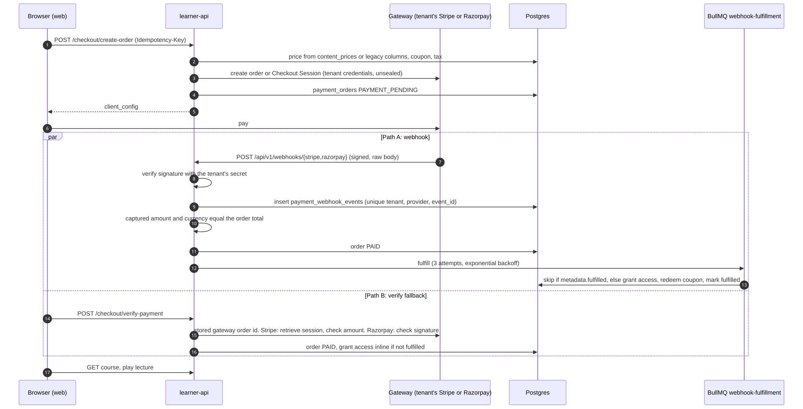

# Payments and currency

Two kinds of money move through the platform:

| Flow | Payer | Payee | Gateway account | API |
| --- | --- | --- | --- | --- |
| Learner checkout | A learner | The tenant | The tenant's own Stripe or Razorpay account | learner-api |
| Platform billing | A tenant | The operator | The operator's Stripe or Razorpay account (`PLATFORM_*` keys) | admin-api |

The platform never holds a tenant's revenue: learner payments settle directly into the
tenant's gateway account ([ADR 0007](../adr/0007-byo-gateway-per-tenant.md)). Paths are
relative to the repository root.

## 1. Gateway connections

A tenant connects a gateway under **Payments** in the tenant admin (admin-api
`/api/v1/tenant/payment`, [`services/gateway-connection.service.ts`](../../apps/admin-api/src/services/gateway-connection.service.ts)):

| Endpoint | Permission |
| --- | --- |
| `GET /config`, `/providers`, `/gateway-connections`, `/gateway-connections/:id` | `gateway.view` |
| `POST /gateway-connections`, `PATCH /gateway-connections/:id`, `DELETE /gateway-connections/:id` | `gateway.configure` (owner-only by default) |
| `GET /orders/export.csv` | `payments.view` |

- Only `RAZORPAY` and `STRIPE`, mode `SELF_MANAGED`.
- Required fields come from the provider's `credential_schema` in `billing_providers`:
  Razorpay `key_id`, `key_secret`, `webhook_secret`; Stripe `secret_key`, `webhook_secret`,
  `publishable_key`.
- Keys are checked live before saving: Razorpay `GET /v1/plans?count=1`, Stripe
  `GET /v1/balance` (against `RAZORPAY_API_BASE` and `STRIPE_API_BASE`). A webhook secret
  cannot be checked this way.
- **Sealed at rest.** The credentials are one JSON object sealed with
  `sealSecret` ([`utils/crypto.ts`](../../apps/admin-api/src/utils/crypto.ts)): AES-256-GCM,
  a random 12-byte IV, key `sha256(CREDENTIALS_ENCRYPTION_KEY)`, stored as
  `credentials_encrypted = { cipher: "enc:v1:<iv>.<tag>.<ciphertext>" }` (base64 parts).
- **Write-only.** Responses carry `credentials_configured: true|false`, never a secret.
- One connection is active at a time; activating one deactivates the others, and the active
  connection cannot be deleted.
- `GET /config` returns the webhook URLs to paste into the gateway dashboard:
  `<LEARNER_API_PUBLIC_URL>/api/v1/webhooks/razorpay` and `.../webhooks/stripe`, and the Stripe
  events to subscribe to (`checkout.session.completed`,
  `checkout.session.async_payment_succeeded`, `checkout.session.async_payment_failed`).

learner-api opens the credentials with the same key and format
([`services/payment/gateway.factory.ts`](../../apps/learner-api/src/services/payment/gateway.factory.ts)),
so both APIs must have the same `CREDENTIALS_ENCRYPTION_KEY`.

## 2. Checkout





Source: [`docs/diagrams/checkout-and-fulfillment.mmd`](../diagrams/checkout-and-fulfillment.mmd).

`POST /api/v1/checkout/create-order` ([`services/checkout.service.ts`](../../apps/learner-api/src/services/checkout.service.ts)),
body `{ order_type, item_id, currency, coupon_code }`, header `Idempotency-Key`:

1. Refuse when the tenant is access-managed (403) or the learner already has access (409
   `ALREADY_HAS_ACCESS`).
2. Currency: the requested one if the tenant has it enabled, else the tenant default.
3. Price of the item (`COURSE`, `BOOK`, `BUNDLE`, `BATCH`, `TEST_SERIES`; must be
   `PUBLISHED` in this tenant) through `resolveContentPrice` (section 4).
4. Check the final currency against the gateway (`resolveGatewayCurrency`); an unsupported
   pair fails only if there is something to pay.
5. Apply a coupon: by tenant and upper-cased code; validity window, `max_uses`,
   `max_uses_per_user`, applicable items; a `FIXED` coupon only in its own currency.
6. Tax from the tenant's tax config (an exclusive rate adds to the total).
7. Idempotency: an existing order with the same key is returned (or refused as already paid).
8. Insert `payment_orders` (`ORD-` plus 8 characters), with a best-effort FX snapshot to the
   tenant default and the resolved country.
9. **Total zero:** mark paid (`FREE_NO_PAYMENT`), grant access, redeem the coupon, mark
   fulfilled, done.
10. **Otherwise:** create the gateway order in minor units (`toSmallestUnit`).
    Razorpay returns `{ key_id, order_id, amount, currency }` for Checkout.js; Stripe creates
    a hosted Checkout Session whose return URL is the tenant's storefront
    (`/payment-callback?order_id=...`, from the tenant's primary domain, never from the
    request). The order becomes `PAYMENT_PENDING`.

Carts (`/api/v1/cart`, up to 50 items of `COURSE`, `BOOK`, `BUNDLE`, `BATCH`) create one
order of type `CART` with `cart_order_items` and per-item coupons; a cart is single-currency.

### Path A: webhooks

`/api/v1/webhooks` is mounted with `express.raw` before the JSON parser and before tenant
resolution, because the signature is over the raw body and the tenant is found from the order
([`services/webhook.service.ts`](../../apps/learner-api/src/services/webhook.service.ts)):

| Step | Razorpay (`POST /api/v1/webhooks/razorpay`) | Stripe (`POST /api/v1/webhooks/stripe`) |
| --- | --- | --- |
| Find the order | `payload.payment.entity.order_id`, across tenants | The Checkout Session id, across tenants |
| Verify | HMAC-SHA256 of the raw body in `X-Razorpay-Signature`, with the connection's `webhook_secret` (falls back to `key_secret`) | `stripe.webhooks.constructEvent` with the connection's `webhook_secret` (includes the timestamp tolerance) |
| Dedup | Insert into `payment_webhook_events` on `(tenant_id, provider_name, event_id)`; a conflict answers 200 `duplicate` | Same, on `event.id` |
| Check | The captured `amount` and `currency` must equal the order total; a mismatch is acknowledged, logged and leaves the order unpaid | `amount_total` and `currency` of the session, the same way |
| Act | `payment.captured`: order `PAID`, queue fulfillment. `subscription.*`: learner subscriptions | `checkout.session.completed`, `async_payment_succeeded`: `PAID` (or wait while `unpaid`), queue fulfillment. `async_payment_failed`, `expired`: order `FAILED` |

An event for an unknown order answers 200 so the gateway stops retrying. The response is
sent once the job is queued; fulfillment itself runs in the worker.

### The fulfillment worker

Queue `webhook-fulfillment` ([`queues/webhook-fulfillment.queue.ts`](../../apps/learner-api/src/queues/webhook-fulfillment.queue.ts)):
job id `webhook-fulfill-<orderId>-<eventId>`, 3 attempts, exponential backoff from 10 seconds,
concurrency 5 per process. The worker re-reads `metadata.fulfilled` and stops if set;
otherwise it grants access, redeems the coupon once, marks the order fulfilled, marks the
event processed and queues the purchase emails.

`grantAccessForSingleItem`:

| Order type | Access |
| --- | --- |
| `COURSE` | Upsert `enrollments` (`PURCHASED`, `valid_till` from the course's validity) |
| `BOOK` | Upsert `book_access` |
| `BUNDLE` | For each bundle item: an enrollment, book access or test series enrollment with source `BUNDLE` |
| `BATCH` | `batch_enrollments` plus each child course or book with source `BATCH`; validity from the batch end date or duration |
| `TEST_SERIES` | `test_series_enrollments` |
| `CART` | Each item through the above |

### Path B: verify fallback

`POST /api/v1/checkout/verify-payment`, called by the storefront after the gateway returns:

- The order must belong to the learner and be `PAYMENT_PENDING` (or already `PAID`).
- The gateway order id is always the order's stored `gateway_order_id`; a request naming
  another one is refused with `Payment does not belong to this order`
  ([`services/payment/order-match.ts`](../../apps/learner-api/src/services/payment/order-match.ts)).
- **Stripe:** the API retrieves the Checkout Session by that stored id, trusts only the
  gateway's answer, and requires the paid amount and currency to equal the order total.
- **Razorpay:** the API checks the Checkout signature, HMAC-SHA256 of
  `order_id|payment_id` with the key secret, over the stored order id. The Razorpay order
  was created for exactly the order total, so the signature also pins the amount.
- The order is marked `PAID`, and if the webhook has not fulfilled it yet, access is granted
  inline.

`POST /api/v1/checkout/verify-and-fulfill` re-queues fulfillment for a `PAID` order, and for a
pending Razorpay order asks Razorpay for a captured payment first; only a capture of exactly
the order total settles it. Cart verification follows the same rules.

### Idempotency layers

| Layer | Mechanism |
| --- | --- |
| Order creation | `payment_orders.idempotency_key` (unique), from the `Idempotency-Key` header |
| Webhook delivery | `payment_webhook_events (tenant_id, provider_name, event_id)` unique |
| Queue | Job id per order and event |
| Fulfillment | `payment_orders.metadata.fulfilled`, checked before and set after |
| Access rows | Upserts on the enrollment and access tables |
| Coupon count | `metadata.coupon_incremented` on cart orders |
| Platform billing | `billing_webhooks.event_id` unique |

### Refunds

Learners cannot refund their own orders: learner-api has no refund endpoint. A refund is
issued in the gateway's dashboard, on the tenant's own account. The platform does not handle
refund webhooks, so the order stays `PAID` and access stays granted until staff revoke it in
the tenant admin (`DELETE /api/v1/tenant/members/:memberId/enrollments/:enrollmentId` and the
book, batch and test series equivalents, `members.update`). See the gaps in section 8.

## 3. Learner subscriptions

Tenants can sell recurring plans (`tenant_subscription_plans`) to learners:
`/api/v1/subscriptions` (`GET /plans`, `POST /subscribe`, `POST /verify-auth`, `GET /my`,
`POST /my/cancel`, `GET /my/access`). This is implemented for **Razorpay only**; a Stripe
connection answers `Subscription service is not available for this payment provider`. The
`subscription-lifecycle` worker handles grace periods, dunning, reminders and pending
verifications. An active subscription counts as course access in the playback check.

## 4. Price books and currencies

Prices are per currency, set by the tenant; nothing converts catalog prices at runtime.

| Source | Holds |
| --- | --- |
| `content_prices` | One row per tenant, entity type, entity and currency (price, discount) |
| Legacy columns | `price_inr`, `price_usd` and their discounts on courses, books, bundles, batches, test series; a permanent first-class source for INR and USD |
| `tenant_currencies` | Enabled currencies, exactly one `is_default` (partial unique index), `countries` (ISO codes, `*` for the rest of the world). No rows means a virtual default: INR for `IN`, USD (default) for everyone else |

**Writes** go through one place,
[`apps/admin-api/src/services/content-prices.service.ts`](../../apps/admin-api/src/services/content-prices.service.ts),
used by all five entity services: a `prices[]` payload is mirrored into `content_prices` and
INR and USD are also written to the legacy columns; a legacy-only write creates INR and USD
rows only while those currencies are enabled. A paid item needs a default-currency price to
be published.

**Reads**, `resolveContentPrice` ([`apps/learner-api/src/utils/price-resolver.ts`](../../apps/learner-api/src/utils/price-resolver.ts)):

```
effective[c] = content_prices[c] ?? (c in {INR, USD} and enabled ? legacy[c] : null)
price = effective[requested]          PRICE_BOOK or LEGACY_COLUMNS
     ?? effective[tenant default]     DEFAULT_FALLBACK
     ?? first enabled with a price    ENABLED_FALLBACK
     ?? "not available for purchase"
```

**Buyer currency**, `GET /api/v1/currency-context`
([`services/currency-context.service.ts`](../../apps/learner-api/src/services/currency-context.service.ts)):
the member's saved preference if still enabled, else the country (`cf-ipcountry`, then
geoip on the client IP, then a time zone hint) matched against `tenant_currencies.countries`
(exact, then `*`), else the default.

**Tenant settings**, admin-api `/api/v1/tenant/currency-settings` (`settings.currencies`):
`GET /`, `PUT /`, `GET /coverage` (which items lack a price in which currency), and
`GET /fx-suggest` (display-only conversions to pre-fill prices). Removing a currency that has
prices first answers `requires_confirmation`; with `confirm_removal: true` it deletes those
rows in the same transaction. Not entitlement-gated.

**Registry.** ISO 4217 decimals and gateway support for 34 currencies, mirrored in four files:
`apps/{console,admin,learner}-api/src/utils/currency-registry.ts` and
`packages/shared/src/constants/currencies.ts`. Every gateway amount goes through
`toSmallestUnit(amount, code)` (JPY 0 decimals, INR and USD 2, KWD and BHD 3). Stripe
amounts in BHD, JOD, KWD, OMR and TND must be multiples of 10.

**FX** is used only for display suggestions and the order snapshot
(`fx_rate_to_tenant_default`), refreshed daily by admin-api's `fx-refresh` worker into
`platform_exchange_rates`. It never changes what a learner is charged.

## 5. Coupons

admin-api `/api/v1/tenant/coupons` (`coupons.*` permissions): `PERCENTAGE` (at most 100) or
`FIXED`, `max_uses`, `max_uses_per_user`, `is_public`, all items or a list. A coupon takes a
`currency`: a `FIXED` coupon requires one the tenant has enabled (INR or USD when the tenant
has no currency rows) and applies only in it; a `PERCENTAGE` coupon stores none and applies
in any currency. At checkout, a fixed coupon with no currency (older rows) is treated as
INR. Learners
see public coupons through `GET /api/v1/checkout/available-coupons` and check one with
`POST /api/v1/checkout/validate-coupon`.

## 6. Invoices and receipts

Learners list their invoices at `GET /api/v1/invoices` (`invoices` table) and their orders at
`GET /api/v1/payment-history`; tenant staff see invoices under `/api/v1/tenant/invoices`
(`invoices.view`). Platform plan invoices are PDFs in S3 under
`invoices/plans/<tenantId>/<subscriptionId>.pdf`.

## 7. Platform billing: tenants paying the operator

The operator sells plans to tenants through its own gateway account, configured with
`PLATFORM_RAZORPAY_KEY_ID`, `PLATFORM_RAZORPAY_KEY_SECRET`, `PLATFORM_RAZORPAY_WEBHOOK_SECRET`,
`PLATFORM_STRIPE_SECRET_KEY`, `PLATFORM_STRIPE_WEBHOOK_SECRET` and
`PLATFORM_STRIPE_PUBLISHABLE_KEY` on admin-api
([`services/billing`](../../apps/admin-api/src/services/billing)):

1. In the tenant admin, **Plans** lists public plans (`GET /api/v1/tenant/plans`) and checks
   eligibility (current usage must fit the new plan's limits).
2. `POST /api/v1/tenant/subscriptions/create-checkout` (`billing.manage`, currency INR or USD)
   validates that the version is live, creates or reuses the external plan, creates a
   provider subscription, stores a `pending_subscription_checkouts` row and returns the
   hosted checkout link. Free plans use `POST /api/v1/tenant/plans/activate-free`.
3. The provider calls `POST /api/v1/webhook/razorpay/subscription` (`x-razorpay-signature`)
   or `POST /api/v1/webhook/stripe/subscription` (`stripe-signature`), mounted with a raw
   body. The Stripe adapter translates `customer.subscription.*` and `invoice.paid` into the
   same events Razorpay sends.
4. Each event is inserted into `billing_webhooks` (unique `event_id`); a duplicate answers 200.
5. `subscription.authenticated` or `activated` runs the entitlement snapshot
   ([multi-tenancy-and-entitlements.md](multi-tenancy-and-entitlements.md#4-the-snapshot)),
   sets the tenant `ACTIVE` and issues an invoice. `subscription.charged` renews.
   `pending` and `halted` start dunning and the grace period. `cancelled` and `completed`
   archive `PLAN` entitlements and suspend the tenant if nothing else is active.
6. Workers: `subscription-poll-reconciliation` asks the provider about pending checkouts every
   2 minutes (in case a webhook is lost), `grace-period-expiry` suspends tenants past grace,
   `subscription-notification` sends dunning notices.

The operator can also assign plans by hand in the console without any payment.

## 8. Gaps

- **Refunds outside the platform.** Refunds happen in the gateway dashboard and no refund
  webhook is handled: the order stays `PAID` and access is kept until staff revoke it by
  hand. The `refunds` table is not written.
- **Razorpay event ids.** The event id is read from the body's `id`, with a time-based
  fallback; if a delivery has no body id, deduplication relies on `metadata.fulfilled` only.
- **No outbox.** The webhook records the event, marks the order paid and then adds the
  queue job in separate steps. If the job add fails, a gateway retry is answered as a
  duplicate and the order waits for the verify fallback or `verify-and-fulfill`.
- **Webhook secret fallback.** Razorpay verification falls back to `key_secret` when a
  connection has no `webhook_secret`.
- **Stripe** has no reconciliation for orders stuck in `PAYMENT_PENDING` (no payments lookup)
  and no learner subscriptions.
- **Platform billing** events that fail are marked `FAILED` and never retried (a retry hits
  the unique `event_id`); the poll reconciliation is the safety net. `trial_days` on
  `create-checkout` is taken from the request without an upper bound.
- Tenants can set `platform_commission_pct` and `platform_commission_flat` when they create or
  update a gateway connection. Checkout sets the platform fee to zero today, so the values have no
  effect, but they should be operator-only.
