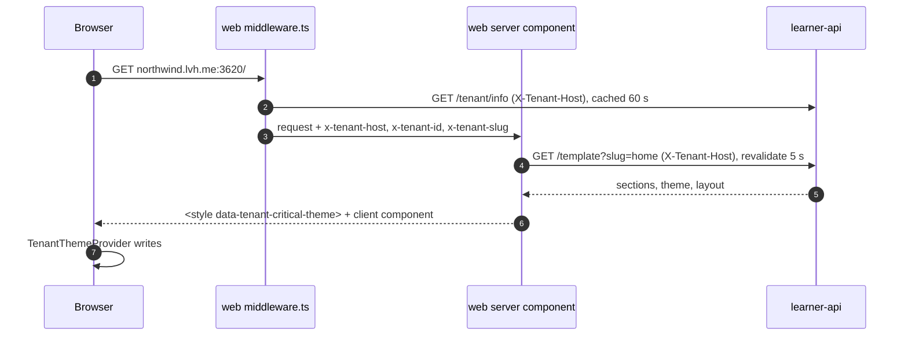

# Templates and theming

Every storefront page is data: a JSON list of sections plus a theme, stored per tenant and
rendered by one shared section registry. Tenants pick a page template, edit sections and
colours in the tenant admin, and publish; the learner storefront renders the published JSON
with the tenant's theme applied before first paint. The decision is
[ADR 0004](../adr/0004-json-page-templates.md). Step-by-step instructions for adding a
section or a template are in [add-a-template.md](../guides/add-a-template.md). Paths are
relative to the repository root.

## 1. Where things live

| Concern | Code |
| --- | --- |
| Page and section types | [`packages/shared/src/types/page.ts`](../../packages/shared/src/types/page.ts) (`PageConfig`), [`packages/shared/src/types/section.ts`](../../packages/shared/src/types/section.ts) (`SectionType`, `SectionConfig`, one content interface per type, `SectionContentMap`) |
| Zod schemas | [`packages/shared/src/schemas/section.ts`](../../packages/shared/src/schemas/section.ts) (`sectionTypeSchema`, `sectionConfigSchema`, `contentSchemaMap`), [`schemas/page.ts`](../../packages/shared/src/schemas/page.ts) (`pageConfigSchema`) |
| Section definitions (names, categories, variants) | [`packages/shared/src/constants/sections.ts`](../../packages/shared/src/constants/sections.ts) (`SECTION_DEFINITIONS`, `SECTION_CATEGORIES`) |
| Section registry (default content per type) | [`packages/ui-config/src/sections/registry.ts`](../../packages/ui-config/src/sections/registry.ts) (`sectionRegistry`, `getDefaultContent`) |
| Section components | [`packages/core/src/components/section-editor/sections`](../../packages/core/src/components/section-editor/sections) (131 files), exported from `section-editor/index.ts` |
| Type to component maps | `sectionComponents` in [`apps/web/src/components/sections/section-renderer.tsx`](../../apps/web/src/components/sections/section-renderer.tsx) and [`apps/admin/src/components/sections/section-renderer.tsx`](../../apps/admin/src/components/sections/section-renderer.tsx) |
| Page templates | [`packages/lms-templates/src/page-templates.ts`](../../packages/lms-templates/src/page-templates.ts) (`pageTemplates`, 58 entries); mirrored for admin-api in [`apps/admin-api/src/data/page-template-catalogue.json`](../../apps/admin-api/src/data/page-template-catalogue.json) (`templates`, `utilityTemplates`, `themes`) |
| Theme presets | [`packages/ui-config/src/themes/palettes.ts`](../../packages/ui-config/src/themes/palettes.ts) (`themePresets`, 43 presets, `defaultThemeConfig`, `getThemePreset`) |
| Course page, book page, LMS player, certificate templates | `packages/course-templates`, `packages/book-templates`, `packages/lms-templates/src/templates`, `packages/certificate-templates` |
| Storage | `tenant_pages` (one row per tenant and slug), `tenant_page_revisions`, `tenants.layout` |

## 2. The data

`tenant_pages` holds one row per `(tenant_id, slug)`:

| Column | Holds |
| --- | --- |
| `sections` | `SectionConfig[]` |
| `theme` | `ThemeConfig` |
| `seo` | `SEOConfig` |
| `is_published`, `published_at` | The storefront only reads published pages |
| `render_mode` | `SECTIONS` (default) or `CUSTOM_CODE` |
| `custom_html`, `custom_html_draft`, `custom_code_kind`, `custom_code_kind_draft` | A tenant-written HTML page (see section 6) |
| `moderation_status` | `ACTIVE` unless flagged |

A section:

```ts
interface SectionConfig {
  id: string;
  type: SectionType;        // "hero", "course-listing", "faq", ... (211 ids)
  variant: string;          // one of the type's registered variants
  order: number;
  visible: boolean;
  deleted: boolean;
  content: unknown;         // shape given by SectionContentMap[type]
  settings: SectionSettings; // background, padding, fullWidth, customClasses, photos
  createdAt: string;
  updatedAt: string;
}
```

Course and book landing pages are `tenant_pages` rows too, at slugs `courses/<slug>` and
`books/<slug>`, created in the same transaction as the course or book row. The tenant-wide
header, footer and navigation are a `TenantLayout` in `tenants.layout`.

A theme (`ThemeConfig`, [`packages/shared/src/types/theme.ts`](../../packages/shared/src/types/theme.ts)):

| Field | Holds |
| --- | --- |
| `colors.light` | 21 colour keys: `primary`, `secondary`, `accent`, `background`, `foreground`, `muted`, `card`, `border`, `input`, `ring`, `destructive`, `success`, `warning` and their `*Foreground` pairs |
| `colors.dark` | Required `background`, `foreground`, `card`, `cardForeground`, `muted`, `mutedForeground`, `border`, `input`; optional overrides of the brand colours, which otherwise fall back to the light values |
| `fonts` | `heading`, `body`, weights; choices from `AVAILABLE_FONTS` (24 Google Fonts) |
| `spacing` | Section padding, container width, gaps |
| `borders` | Radius scale |
| `mode` | `light`, `dark` or `system` (stored; the storefront's dark mode is driven by `next-themes` instead, see section 4) |

## 3. Editing and publishing (tier 2)

The page editor is `apps/admin/src/app/(dashboard)/dashboard/pages/[id]/editor/page.tsx`: a
section panel, a theme panel, device-frame preview, and the same `SectionRenderer` the
storefront uses, so what staff see is what learners get. The list of sections staff can add
is the curated `BASIC_SECTION_TEMPLATES` in
[`apps/admin/src/components/editor/basic-section-templates.ts`](../../apps/admin/src/components/editor/basic-section-templates.ts),
not every registered type.

admin-api `/api/v1/pages` ([`routes/pages.route.ts`](../../apps/admin-api/src/routes/pages.route.ts)):

| Method and path | Permission | Does |
| --- | --- | --- |
| `GET /section-types` | `pages.view` | The section vocabulary |
| `GET /templates`, `POST /templates/apply` | `pages.view`, `pages.update` | List the home page templates, apply one (home or utility, by id) to a page |
| `GET /palettes`, `POST /templates/apply-theme`, `POST /templates/restore-theme` | `pages.view`, `pages.update` | Site palettes: apply colours only, or restore |
| `GET /`, `GET /homepage`, `GET /:id` | `pages.view` | Read pages (any publish state) |
| `POST /`, `POST /:id/duplicate` | `pages.create` | Create, duplicate |
| `PUT /:id` | `pages.update` | Save sections, theme, SEO, custom code draft |
| `POST /:id/sections/remove`, `POST /:id/sections/insert` | `pages.update` | One-section edits |
| `GET /:id/revisions`, `POST /:id/revisions/:revisionId/restore` | `pages.view`, `pages.update` | Revisions of custom-code pages |
| `POST` or `PATCH /:id/publish` | `pages.publish` | Toggle publish |
| `DELETE /:id` | `pages.delete` | Delete |
| `GET /tenant/:tenantId/slug/:slug` | none | The published page for a tenant and slug |

The header, footer and menu are under `/api/v1/tenant/layout` (`settings.navigation`). AI
section and page generation is under `/api/v1/tenant/pages/ai`
([ai-authoring.md](ai-authoring.md)).

## 4. Rendering on the storefront (tier 3): two layers



1. **Tenant.** [`apps/web/middleware.ts`](../../apps/web/middleware.ts) classifies the host
   (`root`, `subdomain` of `NEXT_PUBLIC_ROOT_DOMAIN`, or `custom`), asks learner-api
   `GET /tenant/info` with `X-Tenant-Host`, caches the answer for 60 seconds, rewrites to
   `/404` when no tenant matches, and forwards `x-tenant-host`, `x-tenant-id` and
   `x-tenant-slug` to the page.
2. **Page config.** `getTemplateForRequest(slug)` in
   [`apps/web/src/lib/template.server.ts`](../../apps/web/src/lib/template.server.ts) calls
   learner-api `GET /template?slug=<slug|home>` with `X-Tenant-Host` and `revalidate: 5`.
   Non-home pages take the homepage's theme, so one theme covers the whole site. The layout
   comes from `tenants.layout`, with older fallbacks.
3. **Layer 1, server.** The page's server component calls `getCriticalThemeCss(theme)`
   ([`theme-css.server.ts`](../../apps/web/src/lib/theme-css.server.ts)), which returns
   `html:root{...}` and `html.dark{...}` CSS variables, and injects them as
   `<style data-tenant-critical-theme>`. The first paint is already in the tenant's colours.
   Every value passes `safeCssValue`
   ([`theme-css-value.ts`](../../apps/web/src/lib/theme-css-value.ts)): only plain colours,
   lengths, numbers and font lists are written; anything else is dropped and the default
   applies, so a theme value cannot close the `<style>` element.
4. **Layer 2, client.** The page's client component wraps its content in
   `TenantThemeProvider`
   ([`components/providers/tenant-theme-provider.tsx`](../../apps/web/src/components/providers/tenant-theme-provider.tsx)),
   which writes the same variables into one `<style id="tenant-theme-vars">` (a stylesheet,
   so `.dark` can win), loads the Google Fonts, and exposes `useTenantTheme()`.
5. **Sections.** `SectionRenderer` maps each visible, non-deleted section to its component.
   An unknown type renders a "Coming soon" placeholder; `header` and `footer` are skipped
   because the layout draws them. The header shows the layout's logo, or its logo text, and
   falls back to the tenant's name.

Every page in `apps/web` follows this pattern:

```tsx
// page.tsx (server component)
export default async function CoursesPage() {
  const pageConfig = await getTemplateForRequest("courses");
  const criticalThemeCss = pageConfig ? getCriticalThemeCss(pageConfig.theme) : "";
  return (
    <>
      {criticalThemeCss && (
        <style dangerouslySetInnerHTML={{ __html: criticalThemeCss }} data-tenant-critical-theme />
      )}
      <CoursesPageClient theme={pageConfig?.theme ?? undefined} />
    </>
  );
}

// courses-client.tsx (client component)
export function CoursesPageClient({ theme }: { theme?: ThemeConfig }) {
  return (
    <TenantThemeProvider theme={theme}>
      <CoursesContent />
    </TenantThemeProvider>
  );
}
```

A page without both layers renders in the default palette. Dark mode is `next-themes`
(`attribute="class"`, `defaultTheme="system"`) in the root layout; the toggle shows when
`layout.header.showDarkModeToggle` is set.

Tenant colours can be anything, so components never put text on the tenant `accent` for
hover states: use `hover:bg-muted`, and `bg-primary/10 text-foreground` for active states.
Some components still use `hover:bg-accent` (for example the outline and ghost variants of
the web and core `Button`); see [security.md](security.md#known-gaps) for the list of
rendering issues.

## 5. Templates

| Kind | Package | Registry | In use |
| --- | --- | --- | --- |
| Page templates | `packages/lms-templates` | `pageTemplates` (58: 51 home pages, plus 7 utility pages: about, contact, faq, privacy, terms, profile, login) | Applied from the tenant admin; each is a section list plus a theme preset and SEO defaults |
| LMS player | `packages/lms-templates/src/templates` | `ClassicLMS`, `ModernLMS`, `MinimalLMS`, `getLMSTemplate` | Only `ClassicLMS` is rendered by `apps/web` |
| Course landing page | `packages/course-templates` | `ModernTemplate`, `PhotographyTemplate` | `ModernTemplate` |
| Book page | `packages/book-templates` | `ClassicTemplate`, `ModernTemplate`, `MinimalTemplate`, `AmazonTemplate` | All four, chosen per book |
| Certificates | `packages/certificate-templates` | `CERTIFICATE_TEMPLATES` (17), default `elegant-white` | Chosen per tenant or per course |

A page template entry:

```ts
const academyPageTemplate: PageTemplate = {
  id: "academy",
  name: "Academy",
  description: "...",
  category: "landing",
  pageCategories: ["home"],
  thumbnail: "/templates/academy.png",
  theme: getThemePreset("default"),
  seo: { title: "...", description: "..." },
  sections: [
    s("hero", "split", 0, { content: { title: "..." } }),
    s("course-listing", "grid", 1),
    s("faq", "accordion", 2),
  ],
};
```

admin-api applies templates server-side from its catalogue mirror,
[`page-template-catalogue.json`](../../apps/admin-api/src/data/page-template-catalogue.json),
read by [`lib/page-template-catalogue.ts`](../../apps/admin-api/src/lib/page-template-catalogue.ts):
51 home templates (`templates`, the list `GET /pages/templates` returns), 7 utility
templates (`utilityTemplates`: `login-minimal`, `profile-minimal`, `about-us`,
`contact-us`, `faq-us`, `privacy-us`, `terms-us`, applied by id and never listed in the
picker) and 43 themes. The demo seed builds Northwind's login, profile, about, contact,
FAQ, privacy and terms pages from the utility templates. Regenerate the mirror after the
portal library changes:
`pnpm build --filter @open-mtlms/ui-config --filter @open-mtlms/lms-templates`, then
`node apps/admin-api/scripts/gen-page-template-catalogue.cjs`; an id the mirror does not
know is refused.

AI onboarding in admin-api picks home templates and themes by id. Those ids are generated
into `apps/admin-api/src/lib/creator-intent/types.ts` by
`pnpm --filter @open-mtlms/admin-api sync:frontend-ids`
([`scripts/sync-frontend-ids.ts`](../../apps/admin-api/scripts/sync-frontend-ids.ts)), which
parses `themePresets` and the home entries of `pageTemplates` and rewrites the block between
the `AUTO-GENERATED` markers. Run it after adding or renaming a home template or a theme.

## 6. Custom-code pages

A page can switch `render_mode` to `CUSTOM_CODE` and carry a tenant-written HTML document
instead of sections (Monaco editor at `dashboard/pages/[id]/custom-code`). The draft is saved
in `custom_html_draft` and copied to `custom_html` on publish; revisions are kept in
`tenant_page_revisions`.

The storefront renders it in [`components/custom-code-page.tsx`](../../apps/web/src/components/custom-code-page.tsx)
as a sandboxed `<iframe srcDoc>` without `allow-same-origin`, so the tenant's code runs in an
opaque origin and cannot read the storefront's storage or call the APIs with the learner's
token:

| `custom_code_kind` | Sandbox |
| --- | --- |
| `SANITIZED_INLINE` | `allow-forms allow-popups allow-top-navigation-by-user-activation` (no scripts) |
| `SANDBOXED_IFRAME` | adds `allow-scripts allow-modals allow-downloads` |

A `<base target="_top">` is injected so ordinary links navigate the storefront on a click.

## 7. Caching

| Cache | Where | Lifetime |
| --- | --- | --- |
| Tenant lookup | `apps/web` middleware, per server process | 60 s |
| Page config fetch | Next.js data cache (`revalidate`) | 5 s |
| Tenant config | learner-api, per worker | 60 s; cleared through the Redis channel `<CACHE_BUS_PREFIX>cache-bust:tenant-config` |

A published change is therefore visible within a few seconds. On AWS, `.next/cache` is a
writable task volume ([deploy-aws.md](../guides/deploy-aws.md)).
