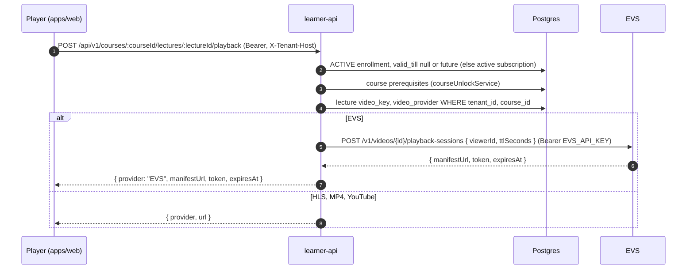

# Video

The LMS stores a reference to each lecture's video and never stores, uploads or transcodes
media itself. A lecture points either at a video in euron-video-system (EVS), a separate
open-source video platform, or at an external HLS, MP4 or YouTube URL. The decision is
[ADR 0005](../adr/0005-evs-for-video.md). Paths are relative to the repository root.

## 1. What a lecture stores

`lectures` ([data-model.md](data-model.md#content)):

| Column | Holds |
| --- | --- |
| `video_provider` | `EVS`, `HLS`, `MP4` or `YOUTUBE` (enum `video_provider`) |
| `video_key` | The EVS video id, or the URL |
| `processing_status` | `PROCESSING`, `PROCESSED`, `FAILED` |
| `duration`, `summary`, `resource_links` | Display data |

Tenant staff paste an EVS id or a URL in the curriculum editor. admin-api normalises it in
`normalizeVideoSource` ([`apps/admin-api/src/services/video-source.service.ts`](../../apps/admin-api/src/services/video-source.service.ts)):

| Provider | Accepted |
| --- | --- |
| `EVS` | An id matching `^[A-Za-z0-9_-]{1,64}$` |
| `YOUTUBE` | A YouTube URL, stored as a canonical watch URL |
| `HLS`, `MP4` | An `https://` URL |

The same file is admin-api's EVS client, used by `/api/v1/tenant/media` (`/providers`,
`/resolve`, `/evs/videos`, `/preview`) and the asset library to look up and list EVS videos
(`GET /v1/videos/:id`, `GET /v1/videos?q&page&limit`, at most 50 per page) and to preview one
as staff (viewer id `<tenantId>:staff:<userId>`).

## 2. Playback for a learner

In [`apps/learner-api/src/services/lecture-playback.service.ts`](../../apps/learner-api/src/services/lecture-playback.service.ts):

1. **Enrollment.** `courseService.ensureEnrolled` requires an `ACTIVE` row in `enrollments`
   for the member and course with `valid_till` null or in the future, or an active learner
   subscription. Then `courseUnlockService.check` enforces prerequisites (403
   `Finish X before starting this course`).
2. **Lecture.** Looked up by tenant, course and lecture id. No lecture or no `video_key`
   answers 404.
3. **Provider.** `video_provider`, or inferred from the key when empty: a YouTube host means
   `YOUTUBE`, `.m3u8` means `HLS`, any other `http(s)` URL means `MP4`, anything else is an
   EVS id.
4. **EVS session.** [`services/evs.client.ts`](../../apps/learner-api/src/services/evs.client.ts)
   posts to `{EVS_API_URL}/v1/videos/{id}/playback-sessions` with
   `Authorization: Bearer {EVS_API_KEY}`, body
   `{ viewerId: "<tenantId>:<memberId>", ttlSeconds: EVS_PLAYBACK_TTL_SECONDS }` (default
   3600) and a 10 second timeout. A missing configuration, a non-2xx answer or an incomplete
   body is a 503.
5. **External URLs** are returned as stored. They are not signed: anyone with the URL can
   play it, so use EVS for paid content.

The viewer id lets EVS watermark, rate-limit and audit per learner, and its session token
limits how long a manifest URL works.

## 3. Free previews

Course landing pages can offer preview videos without sign-in, through
[`course-preview.service.ts`](../../apps/learner-api/src/services/course-preview.service.ts):

- `GET /api/v1/course-previews/:courseSlug` lists the previews: the `previewVideo` of the
  published `courses/<slug>` page plus lessons flagged `course_lessons.is_preview`.
- `POST /api/v1/course-previews/:courseSlug/playback` with `{ videoKey }` mints a playback
  (30 minute TTL) only when the key is in that published set, so the endpoint cannot be used
  to play arbitrary videos.
- The viewer id is `<tenantId>:anon-<first 24 hex of sha256(ip|user-agent)>`.

The lecture playback endpoint does not exempt preview lessons from the enrollment check;
previews go through this endpoint only.

## 4. The player

`VideoPlayer` in `packages/lms-templates/src/components/VideoPlayer` picks a player by provider:

| Provider | Player |
| --- | --- |
| `EVS`, `HLS` | `HlsPlayer` over `CorePlayer`: hls.js (native HLS on iPhone), adaptive bitrate, watermark text, VTT scrub thumbnails, keyboard shortcuts, optional forward-seek lock |
| `MP4` | The same player with a plain `<video src>` |
| `YOUTUBE` | An IFrame API embed; the forward-seek lock is enforced by polling |

`use-lesson-video.ts` asks the page's `getVideoPlayback(lessonId)` for non-YouTube lessons;
`apps/web/src/app/learn/[...slugs]/page.tsx` implements it as the playback POST above. A 403
from it means access was revoked and the page reacts accordingly. For EVS the player uses
`manifestUrl` (plus optional `posterUrl`, `thumbnailsVttUrl`, `watermarkText`).

## 5. Watch time

The player sends heartbeats to
`POST /api/v1/courses/:courseId/lectures/:lectureId/watch/heartbeat` and `/watch/end` (also as
`navigator.sendBeacon` with a `text/plain` body). learner-api writes `lecture_watch_sessions`;
the `watch-time-rollup` worker closes sessions without a heartbeat for 5 minutes, rolls them
into `tenant_watch_time_daily` hourly, and deletes sessions older than 90 days.

## 6. Locally

`EVS_API_URL=http://stubs:5189` points both APIs at the stub, which answers
`POST /v1/videos/:id/playback-sessions` for any id with a bundled 6 second HLS sample
([`apps/stubs/README.md`](../../apps/stubs/README.md)). To use a real EVS deployment, see
[connect-real-providers.md](../guides/connect-real-providers.md#euron-video-system-evs).

## 7. Gaps

- One platform-wide `EVS_API_KEY` is used for every tenant, and admin-api's EVS list and
  lookup do not filter by tenant, so staff of any tenant can list and attach any video in the
  EVS account. Use one EVS account per deployment you trust, or add per-tenant EVS keys.
- The session `token` and `expiresAt` are returned to the player but not used by it; a
  re-mint on 401 or 403 (`onKeyAuthRetry`) is wired in `CorePlayer` but not passed by
  `VideoPlayer`, so a long session can outlive its manifest.
- The lecture endpoint does not check that the course is still published, only that the
  learner holds an active enrollment.
- Learners of a `SUSPENDED` tenant cannot play videos: the status guard refuses every
  non-`GET` request, and playback is a `POST`.
