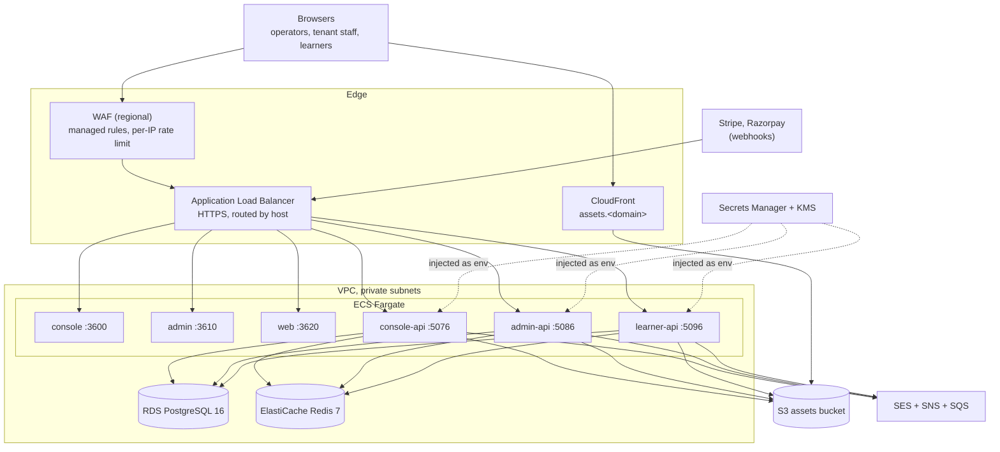

# Deploy to AWS

Run Euron Open Multi-Tenant LMS on your own AWS account with the Terraform in
[`infra/terraform`](../../infra/terraform) and one script,
[`scripts/aws-deploy.sh`](../../scripts/aws-deploy.sh). Paths are relative to the
repository root.

The same modules provision the local Floci emulator on every `make up`
([ADR 0006](../adr/0006-floci-for-local-aws.md)), so the code that talks to S3 and SES is
exercised locally against the resources production uses.

## What gets created





Source: [`docs/diagrams/deployment.mmd`](../diagrams/deployment.mmd).

Everything lives in one module, [`modules/deployment`](../../infra/terraform/modules/deployment/main.tf).
The two environments call it with different sizes and safety switches:

| Setting | `envs/aws-dev` | `envs/aws-prod` |
| --- | --- | --- |
| Availability zones | 2, one shared NAT gateway | 3, one NAT per AZ |
| KMS and Secrets Manager interface endpoints | off | on |
| WAF | on | on |
| RDS | single AZ, 3 days of backups | Multi-AZ, 14 days of backups |
| Deletion protection | off (final snapshot skipped) | on |
| Redis | 1 node, 1 day of snapshots | 2 nodes with automatic failover, 7 days |
| KMS deletion window, secret recovery window | 7 days, 0 days | 30 days, 30 days |
| API tasks | 512 CPU, 1024 MiB, 1 to 2 per API | 1024 CPU, 2048 MiB, 2 to 10 per API |
| Next.js tasks | 256 CPU, 512 MiB, 1 to 2 per app | 512 CPU, 1024 MiB, 2 to 6 per app |
| Log and flow log retention | 14 days | 365 days |

The modules:

| Module | Creates |
| --- | --- |
| `network` | VPC over 2 or 3 AZs, public subnets (ALB, NAT), private subnets (tasks, RDS, Redis), an S3 gateway endpoint, flow logs, deny-all default security group |
| `kms` | One customer-managed key with annual rotation; encrypts RDS, Redis, Secrets Manager, ECR, logs, the bucket and the SES topics |
| `secrets` | `<name_prefix>/app` with generated `JWT_SECRET` (64), `LEARNER_JWT_SECRET` (64), `CREDENTIALS_ENCRYPTION_KEY` (64) and `INTERNAL_API_KEY` (48); `<name_prefix>/providers` when `provider_secrets` is non-empty |
| `database` | RDS PostgreSQL 16, private, encrypted, `rds.force_ssl`, generated master password in `<name_prefix>/database`, Performance Insights |
| `cache` | ElastiCache Redis 7 with TLS, an AUTH token and `maxmemory-policy noeviction` (BullMQ); the full `rediss://` URL is a secret injected as `REDIS_URL` |
| `email` | The SES sending identity with DKIM and a custom MAIL FROM, a configuration set, and the events pipeline (SNS topic, SQS queue, dead-letter queue) |
| `storage` | The private, versioned, TLS-only assets bucket; CloudFront may read only `public/` |
| `cdn` | CloudFront for `assets.<domain>`, reading `public/` through Origin Access Control |
| `ecr` | Six image repositories: `console-api`, `admin-api`, `learner-api`, `console`, `admin`, `web` |
| `edge` | One ALB, one certificate for `<domain>` and `*.<domain>`, extra certificates for tenants' custom domains (SNI) |
| `waf` | Regional web ACL: AWS common and known-bad-inputs rule sets, a per-IP limit of 3000 requests per 5 minutes that exempts `/api/v1/webhook*` paths |
| `service` | One Fargate service per app: own security group and roles, read-only root filesystem, circuit breaker with rollback, CPU target tracking at 60% |
| `observability` | An SNS alarm topic (optionally emailed), per-service error and health alarms, a failed-jobs alarm, dead-letter queue alarms, one dashboard |

## Hosts

The ALB routes by host header. Every name is under the `domain` you set:

| Host | Service |
| --- | --- |
| `console.<domain>` | console (operator console) |
| `api-console.<domain>` | console-api |
| `admin.<domain>` | admin (tenant admin) |
| `api-admin.<domain>` | admin-api |
| `api.<domain>` | learner-api |
| `assets.<domain>` | CloudFront media CDN |
| `<domain>`, `<tenant>.<domain>`, custom domains | web (the lowest-priority rule matches any host) |

Background jobs run inside the API tasks (BullMQ on ElastiCache); there is no separate
worker service. A one-off task definition on the console-api image runs the migrations and
the operator bootstrap.

## Prerequisites

- An AWS account and credentials for it (`aws sts get-caller-identity` works).
- `terraform` (1.10 or newer, from [`versions.tf`](../../infra/terraform/envs/aws-prod/versions.tf)),
  `docker` with `buildx`, the AWS CLI and `python3`. The script checks for each.
- A domain. Either a Route53 hosted zone for it (certificates and DNS are then automatic),
  or two ACM certificates you bring: a regional one for `<domain>` and `*.<domain>`, and a
  `us-east-1` one for `assets.<domain>`.
- Production SES access for the sending domain if you want to mail anyone outside the
  sandbox's verified addresses.

## 1. Configure

```bash
cd infra/terraform/envs/aws-dev        # or aws-prod
cp terraform.tfvars.example terraform.tfvars
cp backend.tf.example backend.tf       # recommended: state in S3
```

Edit `terraform.tfvars`:

| Variable | Meaning |
| --- | --- |
| `region` | AWS region |
| `name_prefix` | 3 to 24 lowercase letters, digits and hyphens; prefixes every resource |
| `domain` | Storefront apex, for example `lms.example.com`; the platform hosts sit under it |
| `route53_zone_id` | Hosted zone for automatic certificates and DNS. Without it set `certificate_arn` and `cdn_certificate_arn`, then publish the records from the outputs |
| `custom_domain_certificate_arns` | One regional ACM certificate per tenant custom domain |
| `mail_domain` | SES sending domain (defaults to `domain`) |
| `product_name` | `BRAND_NAME` and the mail sender name (default `Open LMS Cloud`) |
| `alarm_email` | Address subscribed to the alarm topic |
| `cpu_architecture` | `X86_64` (default) or `ARM64` (Graviton) |
| `db_instance_class`, `cache_node_type` | Defaults `db.t4g.small`, `cache.t4g.small` |
| `evs_api_url` | Base URL of your euron-video-system deployment (empty disables EVS playback) |
| `ai_provider`, `ai_base_url`, `ai_text_model`, `ai_image_model` | AI authoring; `ai_provider` defaults to `offline` |
| `provider_secrets` | Platform provider keys by env name (`EVS_API_KEY`, `AI_API_KEY`, `PLATFORM_*`) |
| `api_extra_environment`, `api_extra_secrets` | Anything else the APIs read, as plain env or ECS secret references |
| `log_level` | `LOG_LEVEL` (default `info`) |

`JWT_SECRET`, `LEARNER_JWT_SECRET`, `CREDENTIALS_ENCRYPTION_KEY` and `INTERNAL_API_KEY` are
generated into `<name_prefix>/app`; do not set them. The task definitions set
`TRUST_PROXY=1` (the load balancer) and leave the auth rate limits at their defaults
([security.md](../architecture/security.md#1-authentication-per-tier)).

Values in `provider_secrets` land in Terraform state. Pass `"set-me"` for each key you want
injected and replace the secret by hand afterwards; Terraform ignores later changes to the
secret's value:

```bash
aws secretsmanager put-secret-value --secret-id <name_prefix>/providers \
  --secret-string '{"EVS_API_KEY":"<key>","AI_API_KEY":"<key>","PLATFORM_STRIPE_SECRET_KEY":"<key>"}'
```

The state bucket must be private, versioned and encrypted: state holds the generated
secrets.

## 2. Deploy

```bash
make aws-deploy ENV=aws-dev            # TAG defaults to the short git commit
```

[`scripts/aws-deploy.sh`](../../scripts/aws-deploy.sh) runs six steps:

1. `terraform apply -target=module.app.module.ecr`: the registries and their KMS key.
2. Builds and pushes six images for `PLATFORM` (`linux/amd64`, or `linux/arm64` when
   `cpu_architecture = "ARM64"`; a mismatch is refused because the tasks would die with
   `exec format error`). The APIs come from
   [`infra/docker/api.Dockerfile`](../../infra/docker/api.Dockerfile); the three Next.js apps
   from [`infra/docker/next.Dockerfile`](../../infra/docker/next.Dockerfile) with this
   deployment's `NEXT_PUBLIC_API_BASE_URL`, `NEXT_PUBLIC_ROOT_DOMAIN` and the cross-app URLs
   compiled in. `NEXT_PUBLIC_POSTHOG_KEY` is taken from your shell. The admin image's
   `/api/proxy` rewrite targets build arg `API_PROXY_TARGET` when set (compose sets the
   in-network `http://admin-api:5086/api/v1`); the script does not set it, so on AWS the
   rewrite goes to `NEXT_PUBLIC_API_BASE_URL`, the public admin-api host.
3. `terraform apply -target=module.app.module.migrate`: network, database and the migrate task.
4. Runs the migrate task ([`scripts/aws-run-task.sh`](../../scripts/aws-run-task.sh)) and
   requires exit code 0.
5. `terraform apply` for everything else.
6. `aws ecs wait services-stable` for the six services, then prints the URLs.

The images are built from the working tree as it is; the script warns when it has
uncommitted changes. `make aws-plan ENV=aws-prod` shows a plan without applying.

## 3. First operator

```bash
make aws-operator ENV=aws-dev EMAIL=you@example.com
```

This runs `dist-scripts/scripts/bootstrap-operator.js` on the migrate task definition and
prints a one-time password into the task log, which the script echoes. Sign in at
`https://console.<domain>`, change the password, then create the catalog and plans
([walkthrough.md](walkthrough.md)). `make demo` is for local stacks only.

## 4. Provider webhooks

| Who | Provider | URL |
| --- | --- | --- |
| Each tenant, in their own gateway dashboard | Stripe | `https://api.<domain>/api/v1/webhooks/stripe` |
| Each tenant | Razorpay | `https://api.<domain>/api/v1/webhooks/razorpay` |
| The operator (platform billing) | Stripe | `https://api-admin.<domain>/api/v1/webhook/stripe/subscription` |
| The operator | Razorpay | `https://api-admin.<domain>/api/v1/webhook/razorpay/subscription` |

Details and the events to subscribe to: [connect-real-providers.md](connect-real-providers.md).

## 5. Tenant custom domains

1. Request a regional ACM certificate for the tenant's domain and add its ARN to
   `custom_domain_certificate_arns`; apply.
2. The tenant points a CNAME at the `load_balancer_dns_name` output.
3. The tenant verifies the domain in the tenant admin. The learner API then resolves the
   host to that tenant ([HLD.md](../architecture/HLD.md#4-tenant-resolution)).

## Updating

Re-run `make aws-deploy ENV=...` with a new commit. Migrations run before the services roll,
and each service rolls with a circuit breaker that reverts a deployment whose tasks fail
their health checks. A migration is forward-only: if a release must be reverted, its
migration stays applied, so write migrations that the previous release tolerates
([operations.md](operations.md#migrations)).

To change a provider key without a new build, put the new value in the secret and force a
new deployment of the affected services:

```bash
aws ecs update-service --cluster <cluster> --service <name> --force-new-deployment
```

## Tearing down

`aws-dev` has deletion protection off, so `terraform destroy` removes everything, including
the bucket and its objects. `aws-prod` keeps the database, the load balancer and the bucket
until you turn `deletion_protection` off and apply first.

## Cost notes

The fixed cost is the NAT gateways, the ALB, RDS, ElastiCache and at least one task per
service (six). `aws-dev` uses one NAT, a single-AZ database and one Redis node to keep this
down; Graviton (`cpu_architecture = "ARM64"`) is cheaper per task.
